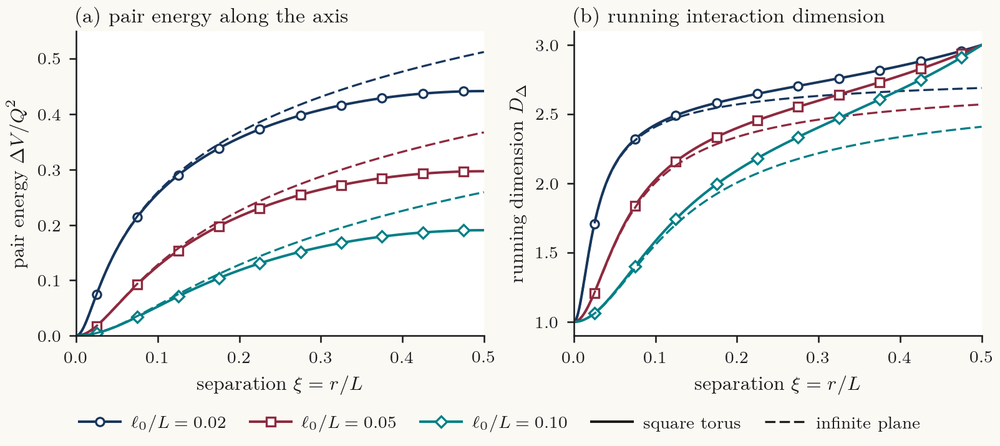

<!-- Author: Dr. Denys Dutykh (Mathematics Department, Khalifa University of Science and Technology, Abu Dhabi, UAE) -->

# tduality: T-duality-regularized electrostatics in finite and bounded planar geometries



The two quantities that the codes compute on a square torus of side L, for a neutral pair of point charges ±Q placed along an axis of the torus at the separation ξ = r/L, and for three values of the zero-point length (ℓ₀/L = 0.02, 0.05 and 0.10); solid curves with markers belong to the torus, dashed curves to the infinite plane. Panel (a) shows the pair energy ΔV/Q², with the self-energies subtracted, which vanishes when the charges coincide: at short separations the torus follows the corrected infinite-plane law (1/4π) ln(1 + r²/ℓ₀²), while at separations of order L the subtraction of the zero mode makes the interaction bounded and periodic, flat at the farthest point ξ = 1/2, where it takes the values 0.442, 0.297 and 0.191 against 0.512, 0.367 and 0.259 in the plane. Panel (b) shows the running interaction dimension: every curve starts from the ultraviolet value 1, and on the torus the dimension reaches 3 exactly at ξ = 1/2, whereas in the plane it approaches 3 only logarithmically (2.69, 2.57 and 2.41 at ξ = 1/2).

In two space dimensions the Coulomb interaction is logarithmic: it diverges at short distance and carries an additive ambiguity at large distance. The T-duality (zero-point length) deformation of Maxwell's theory removes the divergence, and the article by Davide Batic and Denys Dutykh in Proceedings of the Royal Society A (2026), cited below, shows that the large-distance behaviour must then be fixed by the geometry: it builds the Green functions of the deformed theory in finite and bounded planar domains from the spectral calculus of the Laplacian, with the boundary condition imposed before the nonlocal operator is formed, and works them out on the square torus, the grounded half-plane and the grounded strip. This repository holds the two Julia scripts that compute the figures of the article on the square torus, the pair energy and the running interaction dimension, by lattice sums whose truncation is controlled; their reference output with its convergence reports; and the LaTeX sources of the article.

## The problem

The deformation replaces the Maxwell kinetic operator by a nonlocal form factor of the wavenumber k, built on the modified Bessel function K₁ and the zero-point length ℓ₀. In the infinite plane this amounts to sourcing every point charge by a normalised charge cloud, and the energy of a neutral pair, once the self-energies are subtracted, is finite at the origin and recovers the logarithmic Coulomb law at large distance:

```text
f(k) = ℓ₀ k K₁(ℓ₀ k)                                   form factor
ρ(r) = (π ℓ₀²)⁻¹ (1 + r²/ℓ₀²)⁻²                        charge cloud, of total charge one
ΔV_∞(r) = (Q²/4π) ln(1 + r²/ℓ₀²)                       neutral-pair energy in the plane
```

In a bounded domain or on a compact surface, let A_B = −Δ_B be a non-negative self-adjoint realisation of the Laplacian with the boundary condition B, and P⊥ the orthogonal projector that removes its zero modes. The Green operator of the deformed theory is the spectral function

```text
G = F(A_B) A_B⁻¹ P⊥,        F(λ) = ℓ₀ √λ K₁(ℓ₀ √λ)  for λ > 0,   F(0) = 1.
```

On the square torus the zero mode must be removed, which is the uniform neutralising background that charge neutrality requires on a compact space; in the grounded half-plane a Dirichlet boundary gives an image representation with a finite self-energy, and the grounded strip, with two Dirichlet boundaries, has a closed form summed over images. The running interaction dimension is built from the neutral-pair energy, so that no additive constant enters it, and it measures how the interaction scales with the separation: it tends to 1 at short distance in every geometry, while its behaviour at large distance depends on the geometry (the torus saturates, grounded boundaries screen the logarithm).

The scripts evaluate these quantities on the square torus of side L, along the axial path r = (ξL, 0) with 0 ⩽ ξ ⩽ 1/2, where a = ℓ₀/L. The pair energy is the lattice sum over n = (n₁, n₂) ∈ ℤ² with n ≠ 0

```text
                       a K₁(2π a |n|)
U_ax(ξ; a)  =    Σ     ──────────────  [1 − cos(2π n₁ ξ)],        U_ax = ΔV/Q²,
                n ≠ 0     2π |n|
```

and the running dimension is obtained from it analytically, by differentiating the truncated Fourier series rather than by finite differences:

```text
D_Δ(ξ; a) = 3 − ξ ∂_ξ U_ax / U_ax.
```

The references of the infinite plane, with s = ξ/a, are

```text
U_∞(ξ; a) = (1/4π) ln(1 + ξ²/a²),        D_Δ^∞(s) = 3 − 2s² / [(1 + s²) ln(1 + s²)].
```

The sum is truncated symmetrically, −N ⩽ n₁, n₂ ⩽ N. The cutoff N is chosen so that the analytic estimate of the omitted tail, K₀(2π a N)/π, falls below 10⁻¹⁰, and the result is checked directly against the sum with 2N on the plotting grid; for the running dimension, N is doubled further until the curves for N and 2N differ by at most 10⁻⁸.

## Quick start

With Julia installed, from the root of the repository:

```bash
cd codes
julia plot_torus_potential_pdfjl                    # pair energy on the square torus
julia plot_running_dimension_torus_noqt_fixed.jl    # running interaction dimension
```

The first script is stored as `codes/plot_torus_potential_pdfjl`, with no dot before the extension; Julia runs a file whatever its name, so the command works as written. Each script takes a few seconds, prints its progress and writes into a folder created beside it:

| Script | Output folder | Files |
| --- | --- | --- |
| `plot_torus_potential_pdfjl` | `codes/torus_potential_output_pdf/` | `torus_potential.pdf`, three `torus_potential_a_*.csv`, `convergence_report.txt` |
| `plot_running_dimension_torus_noqt_fixed.jl` | `codes/running_dimension_output_noqt/` | `running_dimension_torus.pdf`, three `running_dimension_a_*.csv`, `running_dimension_convergence_report.txt` |

The files stored in `convergence/` are the reference output of these runs; a run with Julia 1.13 reproduces their CSV files to within 10⁻¹⁵. Both scripts sweep the ratio a = ℓ₀/L over the values 0.02, 0.05 and 0.10 (the constant `A_VALUES`) and the separation ξ = r/L over 501 points of [0, 1/2]; these values and the tolerances are constants near the top of each script.

## Contents

| Folder | Contents |
| --- | --- |
| `codes/` | the two Julia scripts, which compute the figures of the article on the square torus |
| `convergence/` | their reference output: the curves of the three values of a as CSV files and the two convergence reports |
| `latex/APS/` | the LaTeX sources of the article in the REVTeX format of the American Physical Society, with `Makefile` and `figs/` |
| `latex/PRSA/` | the same article in the format of Proceedings of the Royal Society A (class `rsproca_new`), with `Makefile` and `figs/` |
| `docs/figures/` | the figure of this page: `plot_readme_figure.py` draws it from the files of `convergence/` with the style file beside it |

The file `torus_potential_a_*.csv` has the columns `r_over_L, torus_deltaV_over_Q2, infinite_plane_deltaV_over_Q2`: the separation ξ = r/L, the pair energy on the torus U_ax = ΔV/Q² with the zero mode subtracted, and the infinite-plane reference (1/4π) ln(1 + ξ²/a²). The file `running_dimension_a_*.csv` has the columns `xi, D_torus, D_infinite`: the separation ξ, the running dimension on the torus, and the infinite-plane reference D_Δ^∞(ξ/a). The convergence reports give, for each value of a, the cutoff N, the tail estimate and the largest difference between the sums with N and 2N on the plotting grid. In the stored runs this difference is about 2 × 10⁻¹¹ for the pair energy, below the tail tolerance, and zero to the printed digits for the running dimension, so that the departures from the infinite plane seen in the figure are effects of the finite size of the torus, not of the truncation.

## Requirements

The scripts need Julia (they were written with Julia 1.12 and run unchanged with 1.13) and, on their first run, an internet connection. Each script creates its own Julia environment in a hidden folder beside it (`.torus_potential_env_noqt` or `.running_dimension_env_noqt`) and installs there a single package, SpecialFunctions.jl, for the modified Bessel functions K₀ and K₁; nothing else of the Julia installation is touched. The scripts need no plotting package, no graphical interface and no LaTeX: they write their vector PDF figures directly. The figure of this page needs Python 3 with NumPy and Matplotlib, and sets its labels with LaTeX when a TeX installation is present.

## The manuscript

The LaTeX sources of the article are given in two journal formats, which share the text, the figures and the bibliography `FRT.bib`; the figures `figs/torus_potential.pdf` and `figs/running_dimension_torus.pdf` are those written by the two scripts. The version of record is the published article cited below; its title spells regularized, while these sources spell regularised. Each folder has a `Makefile` that runs pdflatex, BibTeX and pdflatex twice, then removes the auxiliary files and keeps `DB-DD-TDuality.pdf`:

```bash
cd latex/PRSA     # or latex/APS
make              # builds DB-DD-TDuality.pdf
make distclean    # also removes DB-DD-TDuality.pdf
```

Building needs a TeX distribution with pdflatex and BibTeX, such as TeX Live. The sources still mark the passages added during the revision: they are wrapped in the macro `revadd`, defined near the top of each `DB-DD-TDuality.tex`, whose active definition prints them in red; making the second, commented definition active instead prints them in black, with the same pagination.

## How to cite

If you use these codes or data, please cite the article:

D. Batic and D. Dutykh, Spectral Green functions for T-duality-regularized electrostatics in finite and bounded planar geometries, Proceedings of the Royal Society A: Mathematical, Physical and Engineering Sciences 482 (2349), 20260600 (2026). The article is open access.

https://doi.org/10.1098/rspa.2026.0600

```bibtex
@article{Batic2026o,
  author = {Batic, Davide and Dutykh, Denys},
  title = {Spectral {{Green}} Functions for {{T}}-Duality-Regularized Electrostatics in Finite and Bounded Planar Geometries},
  journal = {Proceedings of the Royal Society A: Mathematical, Physical and Engineering Sciences},
  year = 2026,
  volume = {482},
  number = {2349},
  pages = {20260600},
  doi = {10.1098/rspa.2026.0600}
}
```

The button "Cite this repository" in the right-hand column of this page gives the same reference, read from `CITATION.cff`.

The codes and data of version 1.0.0 of this repository, the release used in the article, are archived on Zenodo under the DOI 10.5281/zenodo.22096406. The concept DOI of the archive, which the article quotes, always leads to its latest version:

https://doi.org/10.5281/zenodo.22096405

## Licence

GNU Lesser General Public License, version 2.1 (see `LICENSE`).

## Authors

Davide Batic (davide.batic@ku.ac.ae) and Denys Dutykh (denys.dutykh@ku.ac.ae), Mathematics Department, Khalifa University of Science and Technology, Abu Dhabi, United Arab Emirates.

https://www.denys-dutykh.com/
